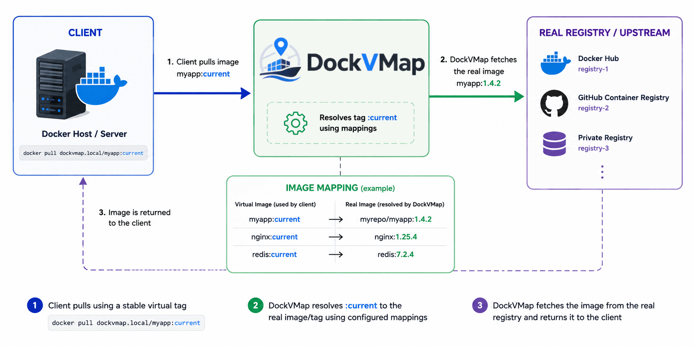
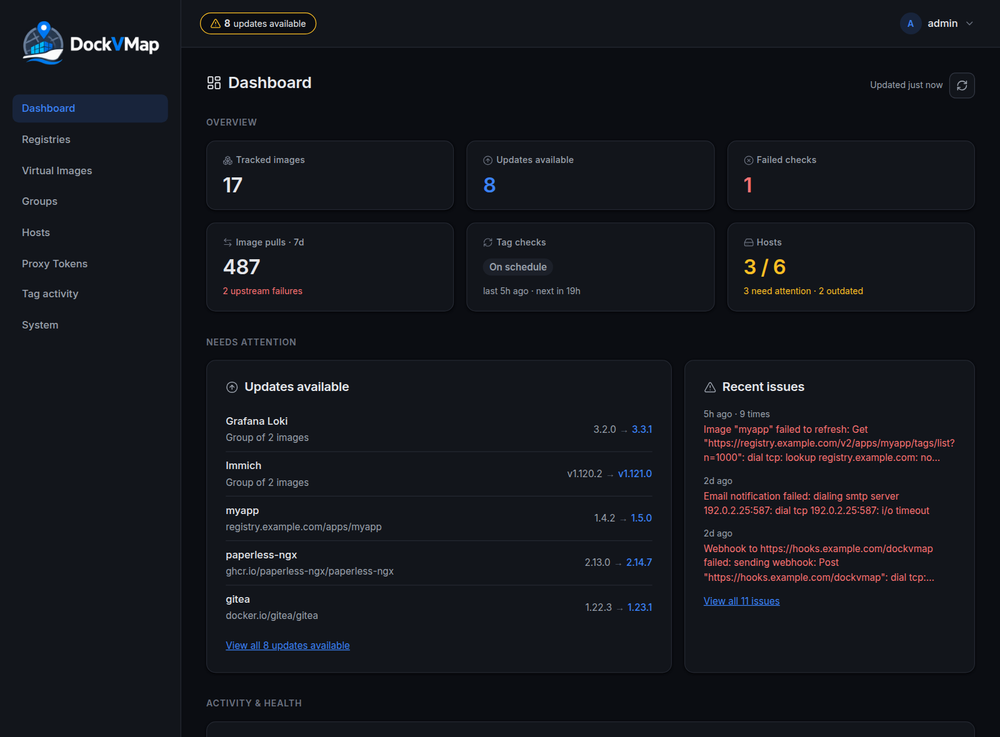
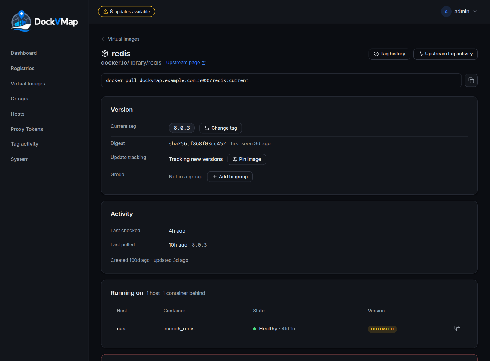
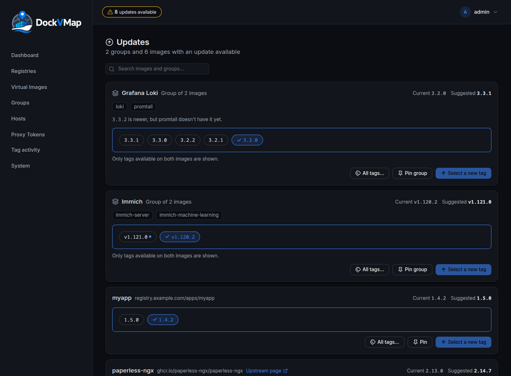
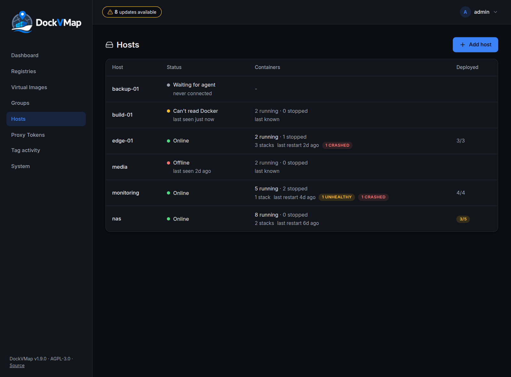

<p align="center">
  
</p>

<h1 align="center">DockVMap</h1>

<p align="center">A self-hosted Docker/OCI registry proxy that gives you a stable tag pointing at a real image version you control.</p>

<p align="center">
  <a href="LICENSE"></a>
  
  
</p>

---

## What it is

DockVMap sits between your Docker clients and a real registry (Docker Hub, GHCR, a private registry, or anything speaking the OCI Distribution API). You point clients at a **virtual tag**, e.g.:

```
docker pull dockvmap.local/myapp:current
```

`current` isn't a real tag on the upstream registry. It's a pointer DockVMap maintains. Behind it, you track a real upstream tag (`myapp:1.4.2`, say) per image, and change what `current` resolves to whenever *you* decide to, from a web UI. Clients never change what they pull; you change what they get.

Tools that list tags, like skopeo, crane, Renovate or diun, see only the virtual tag: `myapp` lists `current`. Renovate or diun tracking the digest of `myapp:current` then notices when you move the tag in DockVMap.

<p align="center">
  
</p>

### Why

`:latest` moves under you with no warning and no audit trail. Hardcoding a specific version tag everywhere it's referenced means every rollout is a find-and-replace across configs. DockVMap adds one layer of indirection so you get a fixed, predictable reference for clients *and* full control over what it actually resolves to, plus a record of when it changed and to what.

## Screenshots

<p align="center">
  
</p>

<p align="center">
  
</p>

<p align="center">
  
</p>

<p align="center">
  
</p>

## Features

- **Virtual tag proxying**: OCI Distribution API proxy (`/v2/...`) that transparently resolves a stable tag to whatever real tag an image is currently pinned to.
- **Tag family analysis**: inspects a repository's real tags, groups them into families, and tells you when a newer tag in the same family becomes available.
- **Updates review**: a dedicated page listing every image with an update, each with all newer tags in its family, so you can compare and update them without opening each image.
- **Image groups**: keep images that release together on one version. Changing the tag of one member changes all of them at once or none of them, only tags available on every member are offered, and the group reviews as a single row on the Updates page. The Groups page lists every group with its shared tag and status, and suggests groups for images that look related.
- **Pinning**: park an image on its current tag from the details page. Upstream tags are still fetched and recorded, but no update is flagged and no upgrade email is sent until you unpin.
- **Registry browsing**: browse the repositories and tags of any registry that lists them, see which ones have no virtual image yet, and add a virtual image from there. See [Browse a registry](#browse-a-registry).
- **Registry usage**: Registries shows how many virtual images use each registry, linked to Virtual Images filtered by that registry, and warns when some of them fail their tag checks, which usually means the registry's login stopped working. A registry still in use links to its virtual images and can't be deleted until they're gone.
- **Tag discovery**: when adding a virtual image, scans the upstream repository in the background (result cached) so you pick from its real tags instead of typing one blind.
- **Tag history**: per-image record of every real tag the virtual tag has resolved to, and when each change happened.
- **Digest tracking**: the digest behind each image's current tag, checked on every tag sweep and right after a tag change, and updated when a pull through DockVMap gets a newer one, so a tag republished under the same name is noticed. Image details shows it with when it was first seen.
- **Web UI**: Svelte SPA for managing registries, virtual images, and reviewing what changed and when.
- **Notifications**: digest emails (SMTP) and/or generic webhooks when a tracked image's tags change. Email volume is selectable per account (every tag change / only when an upgrade becomes available / off); webhooks always fire and carry an `updateAvailable` flag.
- **Optional blob cache**: on-disk manifest/blob cache keyed by digest, to cut repeated upstream pulls.
- **Hosts**: DockVMap reads a small read-only agent on each Docker host, so you see what runs where, with state, health, stacks and ports, and which containers pulled through DockVMap are outdated or pulled but not recreated. See [Hosts and the agent](#hosts-and-the-agent).
- **Internal registry**: run the official `registry:3` next to DockVMap with only DockVMap exposed, and push and pull every image through one address. With `proxy_auth` on, pushes need a proxy token with Can push. Each pushed tag is audited, and a new tag shows as an update within seconds. See [Internal registry](#internal-registry).
- **Pull tracking**: when each image was last pulled through the proxy and which real tag clients got, with a warning when nobody has pulled since the last tag change. A pull that downloads nothing new isn't recorded, so after rolling back to a version your hosts already have, the warning stays until the next real download. Groups show how many members were pulled on the shared tag. Each proxy token shows when it was last used, with a warning once it has gone unused for over 90 days.
- **Proxy authentication**: optional HTTP Basic Auth (via issued tokens) in front of the registry proxy itself.
- **Audit log**: every state-changing action recorded, with resolved client IP and actor.

## How it runs

One binary, one SQLite database, three things running inside it:

- a **proxy server** implementing the OCI Distribution API,
- a **web server** serving the REST management API and the embedded frontend,
- a **background worker** doing tag refresh, notifications, and cleanup on independent schedules.

The optional host agent is a separate binary and image, run on each Docker host you want to see.

## Quick start

The recommended way to run DockVMap is the published Docker image. It bundles the binary with the frontend embedded, and needs only a persistent `/data` volume (SQLite database, credential key, blob cache) and the two ports: `5000` for the registry proxy, `8080` for the web UI.

```bash
docker run -d --name dockvmap \
  -v dockvmap-data:/data \
  -p 5000:5000 -p 8080:8080 \
  ghcr.io/septi0/dockvmap:latest
```

Open the web UI at `http://localhost:8080`. The first visit walks you through creating the initial admin account. Point Docker clients at the proxy on `:5000`.

Pass any config as `DOCKVMAP_*` environment variables (`-e DOCKVMAP_TRUSTED_PROXIES=gateway`, etc.; see [Configuration](#configuration) for the keys). A credential encryption key is generated and persisted to the volume on first run, so registries that require auth work with no upfront setup.

Images for `linux/amd64` and `linux/arm64` are published to `ghcr.io/septi0/dockvmap` and, for the host agent, `ghcr.io/septi0/dockvmap-agent` on every `v*.*.*` tag, as `latest`, `MAJOR.MINOR`, and the full version.

### Docker Compose

`compose.sample.yaml` is a documented starting point; copy it to `compose.yaml`, adjust, and `docker compose up -d`. It runs the same published image, persists `/data` to a named volume, publishes both ports, and adds a healthcheck and `restart: unless-stopped`.

To run your own registry behind DockVMap, start from `compose.registry.sample.yaml` instead; see [Internal registry](#internal-registry).

### Build from source

Run without Docker. Requires Go 1.25+ and Node.js for the frontend build.

```bash
git clone https://github.com/septi0/dockvmap.git
cd dockvmap
make build          # builds the frontend, embeds it, builds bin/dockvmap and bin/dockvmap-agent
mkdir -p data
cp config.sample.yaml data/config.yaml
./bin/dockvmap -config data/config.yaml
```

Running with no config file at all is fine too; it falls back to `DOCKVMAP_*` env vars and defaults. Either way, a credential encryption key is generated and persisted at `<data-path>/credential_encryption.key` on first run; set `credential_encryption_key` yourself only if you want to manage it out of band.

> A plain `go build ./...` will fail on a fresh checkout: the web server embeds `frontend/dist` at compile time, and that directory isn't committed. `make build` (or `make build-frontend` once) handles it.

## Behind a reverse proxy

When a reverse proxy terminates TLS and forwards to the web UI on `:8080`:

- Set `trusted_proxies` (or `DOCKVMAP_TRUSTED_PROXIES`) to the proxy's address: `gateway` if it reaches DockVMap through the published port, or the proxy's own address if it shares a Docker network. See [`trusted_proxies`](#networking) for the specifics.
- Stop publishing `:8080` to the host, so the proxy is the only route in.

Skip both and anything that can reach `:8080` directly can forge `X-Forwarded-For`, defeating client-IP logging and login rate limiting.

## Hosts and the agent

See which containers run on each Docker host, and whether the ones pulled through DockVMap run the version it points to. A small agent on each host reads Docker, and DockVMap connects to it to read what it found. The agent never connects anywhere and never changes anything on the host, so only DockVMap needs a firewall rule to reach your hosts, not the other way around.

### Setup

1. On the **Hosts** page, click **Add host**, give it a name and the address DockVMap reaches it on, like `10.0.20.15` or `nas.lan:9002`. DockVMap shows a ready-to-use compose file.
2. Run the agent on that host: copy `compose.agent.sample.yaml` to `compose.yaml` and `docker compose up -d`. Allow DockVMap to reach the host on the agent's port, `9002` by default.
3. On its next check, DockVMap adopts the agent and the host shows as Online.

### Pairing

The first time DockVMap reaches an agent, it adopts it: each side keeps the other's certificate fingerprint and from then on only talks to that one, over TLS in both directions. The agent keeps its certificate and the pairing in its `/data` volume, so it stays paired across restarts and updates. There are no tokens to copy.

- **An agent paired with another DockVMap** refuses this one, and the host shows **Paired with another DockVMap**. To move it, delete the agent's volume and start it again.
- **An agent with a new identity**, for example after its volume was deleted or the host was reinstalled, isn't trusted on its own: the host shows **Agent identity changed** and DockVMap stops reading it. If you reset the agent yourself, click **Trust new agent** on the host's page.
- **DockVMap's side** of the pairing is `<data-path>/agent_client.pem`. Back it up with the database; without it every agent has to be reset and adopted again.

### Agent settings

All settings are environment variables on the agent.

| Variable | Default | Description |
|---|---|---|
| `DOCKVMAP_AGENT_LISTEN` | `:9002` | Address the agent listens on for DockVMap. |
| `DOCKVMAP_AGENT_PROXY_ONLY` | `false` | Report only containers whose image comes through DockVMap's proxy. Needs [`proxy_public_host`](#networking) set on DockVMap. |
| `DOCKER_HOST` | `unix:///var/run/docker.sock` | Docker to read: a `unix://` socket, or `tcp://` to a socket proxy. |
| `DOCKVMAP_LOG_LEVEL` | `info` | `debug`, `info`, `warn` or `error`. |

The agent keeps its state in `/data` in the image; mount a volume there, as the sample compose file does. It logs its fingerprint at startup, so you can compare it with the one on the host's page in DockVMap.

### Docker access

The agent only reads from Docker: containers, images, system info and events. Mounting the socket with `:ro` doesn't limit what can be done through it, so for strictly read-only access put a socket proxy in front, for example [tecnativa/docker-socket-proxy](https://github.com/Tecnativa/docker-socket-proxy) with `CONTAINERS=1 IMAGES=1 INFO=1 EVENTS=1 VERSION=1`, then set `DOCKER_HOST: tcp://socket-proxy:2375` and drop the socket mount. The sample compose file shows where.

### What it reports

- **The host**: hostname, OS, architecture, CPUs, memory and Docker version.
- **Each container**: name, image, state and health, exit code, compose project, service and folder, when it was created, started and stopped, and its published ports.

Never environment variables, mounts, other labels or logs. DockVMap asks every agent for changes every [`agents_poll_interval`](#core) (30 seconds by default), and opening a host's page asks right away. When nothing changed, the agent answers in a few bytes. A host that misses 3 checks in a row shows as Offline, with the containers it had when it was last online; the reason, like a refused connection, shows on hover.

### Versions

A container whose image comes through DockVMap's proxy, like `dockvmap.local:5000/myapp:current`, is matched to its virtual image by digest. One that runs the version you chose shows nothing extra; one that doesn't shows **Needs a redeploy to run 1.4.2**, whether it still has to pull the new version or only be recreated. A container using another tag through the proxy shows which tag it is pinned to.

The dashboard opens with what needs you: a To redeploy card ("Every container runs the version you chose" when nothing does), with the containers grouped by stack and one command per stack, like `cd /srv/shop && docker compose pull web api && docker compose up -d web api`, to run on that host. It pulls and recreates only those containers; the rest of the stack keeps running. Containers started without Compose are listed without a command. A host's page shows the same summary for that host when it has something to redeploy. Image details lists every host and container running that image. The Virtual Images list shows in its Containers column how many still need a redeploy, like "2 of 5 to redeploy", and the Hosts list shows "3 to redeploy" under a host's containers when it applies. On Virtual Images, the Newer tag column is about the other step: whether the upstream has a tag newer than the one the virtual tag points to. Numbers refresh by themselves, so you can watch a deploy reach every host. Only running or crash-looping containers that use the virtual tag count: a pinned or stopped container stays visible but never holds the number back. Hosts that are offline or can't read Docker can't be checked, so Virtual Images shows how many were left out, and why.

On the Hosts list, "crashed" counts containers that keep restarting or crashed in the last 7 days. Exit codes 137 and 143 come from a normal `docker stop`, so they don't count.

Matching uses the proxy address clients pull from, so set [`proxy_public_host`](#networking); without it, DockVMap guesses from the address you opened the web UI on.

### Limits

- Docker Engine 20.10 or newer (API 1.41). Podman is untested.
- Docker over TLS with client certificates isn't supported; use the local socket, or a socket proxy over `tcp://`.
- Up to 1000 containers and 2000 images per host.
- Agents don't need updating on every DockVMap release. If a new release can't work with an older agent, that host shows as **Update agent** until you update it.

### Build from source

`make build-agent` builds `bin/dockvmap-agent`, one static binary with no dependencies, configured by the same environment variables. Like DockVMap, it takes `-data-path` for its state, `./data` by default (`/data` in the image), and `-version`. `Dockerfile.agent` builds the agent image.

## Browse a registry

On Registries, a Browse icon shows on every registry that lists its repositories (`/v2/_catalog`), like `registry:3` or the internal registry. Docker Hub and GHCR don't list repositories, so they have no Browse icon.

The Browse page lists up to 1000 repositories, with search and a Show filter for the ones with no virtual image yet. Each repository shows its virtual images. Open one to see its tags in families, as in the tag picker, and use **Add virtual image** to start the usual wizard with the registry, repository and tag filled in. Browsing never changes anything in the registry.

DockVMap asks each registry once an hour whether it lists its repositories, and again right after you edit it. Listing uses the registry's saved login, and some registries allow it only for some accounts: Harbor, for example, lists repositories only for admins. New virtual image also suggests repositories for these registries.

## Internal registry

Run the official `registry:3` in the same stack as DockVMap, with only DockVMap exposed, and push and pull every image through DockVMap's proxy address. Virtual tags keep working as before.

DockVMap doesn't replace the registry. `registry:3` stores every image and does the uploads; DockVMap stands in front of it, handles TLS and who can pull or push, and forwards everything else unchanged. Without DockVMap, the registry keeps working on its own.

### Setup

1. Copy `compose.registry.sample.yaml` to `compose.yaml` and `docker compose up -d`. It runs DockVMap with `DOCKVMAP_INTERNAL_REGISTRY_ENABLED: "true"` next to a `registry` service whose port isn't published.
2. Open the web UI and create the admin account. The Registries page lists it first, marked "Internal registry"; DockVMap adds it at startup.
3. Push: `docker push localhost:5000/team/web:v1`.
4. For a virtual tag, add a virtual image from **Internal registry** and repository `team/web`, then `docker pull localhost:5000/web:current`. The repository field suggests what's already in the registry.

The internal registry is reached over plain HTTP on the stack network and must not require a login: DockVMap handles TLS and logins. For a registry that already serves TLS, see [Keeping an existing registry as it is](#keeping-an-existing-registry-as-it-is).

### Moving an existing registry

1. Mount the registry's existing data folder as `/var/lib/registry` in the `registry` service, so every image is kept.
2. Remove the registry's own TLS settings (`REGISTRY_HTTP_TLS_*`) and any `htpasswd` login, and stop publishing its port.
3. If virtual images already use that registry in DockVMap, edit its registry entry and change the address to `registry:5000` before turning the setting on. DockVMap takes that entry over at startup, so those virtual images keep working.
4. Turn on `internal_registry.enabled`, and point clients that pulled real names from the registry at DockVMap's proxy address.

### Keeping an existing registry as it is

To put DockVMap in front of a registry that already serves TLS, without changing the registry or the clients that use it directly:

1. Set `internal_registry.address` to the name and port its certificate is for, like `registry.example.com:5000`, and turn on `internal_registry.tls`. DockVMap connects over HTTPS and checks the certificate, so it must be valid for that name and come from a CA DockVMap trusts, like Let's Encrypt.
2. Turn on `internal_registry.enabled`. If DockVMap already has a registry entry with that address, it takes it over, so its virtual images keep working.

Clients that use the registry directly keep working as before. Their pushes don't go through DockVMap, so they aren't in the audit log and show at the next scheduled tag check instead of within seconds. To finish the move later, follow [Moving an existing registry](#moving-an-existing-registry) and turn `internal_registry.tls` off; DockVMap moves the entry to the new address and its virtual images follow.

### How requests are routed

- **A virtual image's name**: handled as before. The virtual tag is resolved, every other tag passes through to the virtual image's registry. Pushing to a virtual image is refused, since a virtual tag is a pointer DockVMap manages.
- **Any other name**: passed through to the internal registry, pushes included, along with `/v2/_catalog`.
- **A virtual image and a repository with the same name**: pulls go to the virtual image. Pushes and the tag list go to the registry when the virtual image is built on that same repository in the internal registry, like `myapp` on `myapp`, so a CI check sees the tags you pushed; pushing its virtual tag (`myapp:current`) is refused, since DockVMap manages that tag.

Pulls of real names don't count in Last pulled or the dashboard's pull numbers, which are about virtual images.

### Who can push

With [`proxy_auth`](#proxy-authentication-proxy_auth) on, pulls need any proxy token and pushes need a token with **Can push**, chosen when you create it. Give it to your build script; hosts only need to pull. With `proxy_auth` off, anyone who can reach the proxy can push, the same as an open registry, and DockVMap warns about it in the log and on Proxy Tokens.

To limit pushes without tokens on every host, list your build hosts in `internal_registry.push_allowed_ips` (IPs or CIDRs). Pushes and deletes from any other address get `403` with the address that was refused; pulls aren't affected. With `proxy_auth` on, a push needs both: an allowed address and a token with Can push. To find a build host's address, open its `IMAGE_PUSHED` entry in the audit log. Behind a reverse proxy, set [`trusted_proxies`](#networking) too, or every push seems to come from the proxy and is refused. System → Status shows the list in use.

Every pushed tag is recorded in the audit log as `IMAGE_PUSHED`, and every deleted manifest as `MANIFEST_DELETED`, with the token and the client address resolved with [`trusted_proxies`](#networking).

### After a push

A pushed tag starts a tag check for the virtual images built on that repository, about 5 seconds after the last push to it, so a new tag shows as an update within seconds and several tags pushed together cause one check. Re-pushing an existing tag shows its new digest.

Containers that run a real name through DockVMap, like `dockvmap.lan:5000/team/web:latest`, show as from the internal registry on the host's page, and show **Needs a redeploy to run the new image** once a new image is pushed to that tag. They count in the Hosts page and the dashboard summary, but not in any virtual image's Containers column. Pushing through DockVMap updates this within one host check; a push straight to the registry shows within 5 minutes.

### Startup and address changes

At startup DockVMap makes sure a registry entry exists for `internal_registry.address` and marks it as internal: it takes over an existing entry with that address, or adds one. If the address changes, the entry moves with it and its virtual images follow. DockVMap refuses to start if the address isn't `host:port`, or if another registry entry already has the new address. Turning the setting off keeps the entry as a normal registry.

If the registry doesn't answer at startup, DockVMap starts anyway, shows it under Problems on the dashboard, and checks again every 10 seconds; until then, pushes and real pulls get an error that says so.

### Good to know

- Back up the registry's volume separately: `dockvmap -backup` covers DockVMap's database only.
- Garbage collection stays the registry's job: `docker compose exec registry registry garbage-collect --delete-untagged /etc/distribution/config.yml`, when nothing is pushing. `--delete-untagged` also removes the images left behind when you push a tag again, like `latest`, so the volume doesn't keep growing; multi-arch images stay complete (checked with `registry:3` 3.1.2). On `registry:2` the config is `/etc/docker/registry/config.yml`.
- If DockVMap's own image lives in the internal registry, don't pull it through DockVMap, or DockVMap can't be deployed while it's down. Publish the registry on DockVMap's host for loopback only (`127.0.0.1:5000:5000`) and pull DockVMap as `127.0.0.1:5000/<name>`: Docker allows plain HTTP to `127.0.0.1`, and the registry stays unreachable from the network.
- If you turn on deletes in the registry, don't delete the tag a virtual image points to, or pulls of its virtual tag break. A delete through DockVMap starts a tag check for that repository, so a virtual image whose tag is gone shows in Problems on the dashboard within seconds.
- If DockVMap is down, nothing can push or pull real names; the registry itself isn't reachable from outside.

## Configuration

Settings can come from a YAML file, from `DOCKVMAP_*` environment variables, or both; the config file is entirely optional. Precedence per setting is **env var > config file > built-in default**. Omitting `-config` runs on env vars and defaults.

Env var names mirror the YAML keys: uppercased, path segments joined with underscores, prefixed `DOCKVMAP_`. So `proxy_server_listen` becomes `DOCKVMAP_PROXY_SERVER_LISTEN`, and `smtp.host`, `blob_cache.max_size`, and `login_rate_limit.max_attempts` become `DOCKVMAP_SMTP_HOST`, `DOCKVMAP_BLOB_CACHE_MAX_SIZE`, and `DOCKVMAP_LOGIN_RATE_LIMIT_MAX_ATTEMPTS`. List values are comma-separated (`DOCKVMAP_TRUSTED_PROXIES=10.0.0.0/8,192.168.1.1`).

One setting is a CLI flag rather than a config key: `-data-path`, which sets where the database and credential key live (see [CLI](#cli)).

Every setting is optional. The Default column gives the built-in value; `none` means unset and `auto` means derived from other settings, with the Description saying how. [`config.sample.yaml`](config.sample.yaml) is a starting point; these tables are the complete list.

### Core

| Key | Default | Description |
|---|---|---|
| `virtual_tag` | `current` | The tag name clients pull instead of a real upstream tag. |
| `tags_check_interval` | `24h` | Minimum time between upstream tag-change polls. The last poll time is persisted, so restarts don't reset the interval. |
| `agents_poll_interval` | `30s` | How often DockVMap asks each host's agent for changes. A host that misses 3 checks in a row shows as Offline. |
| `tag_discovery_ttl` | `1h` | How long a repository's discovered tag list (shown when adding a virtual image) is cached before a "Check repository" click refreshes it in the background. |
| `session_lifetime` | `168h` | Web UI session duration. |
| `logs_path` | none | Directory for log files. Unset logs to stdout only. |
| `log_level` | `info` | Minimum log level: `debug`, `info`, or `warn`. `debug` adds per-request proxy tracing; `warn` drops routine informational lines. |
| `tag_filters_path` | none | Path to a `filters.yaml` policy file (see [Tag filtering](#tag-filtering)). If set, the file must exist; an invalid path is a startup error, not a silent fallback. Unset uses the built-in default filters. |
| `credential_encryption_key` | none | Base64, 32-byte AES-GCM key encrypting stored registry credentials. Unset generates one and persists it at `<data-path>/credential_encryption.key` on first run. |

### Networking

Bind addresses are where DockVMap listens; `proxy_public_host` is only what the UI advertises to clients. Set `trusted_proxies` whenever a reverse proxy sits in front; otherwise client-IP logging and login rate limiting key off the proxy's address instead of the real client's.

| Key | Default | Description |
|---|---|---|
| `proxy_server_listen` | `:5000` | Registry proxy bind address. Serves HTTPS in place when `tls.enabled` is true. |
| `proxy_public_host` | none | Host clients use in `docker pull`, shown in the web UI's pull instructions. May include a port (`registry.example.com:5050`) to override `proxy_server_listen`'s port too, for when the publicly reachable port differs from the bind port. Port 443 is left out of pull commands. Unset lets the web UI guess from the browser's request host, which can be wrong behind a reverse proxy. |
| `proxy_access_log` | `true` | Write one structured log line per `/v2/...` request (method, path, status, bytes, duration, client address, resolved virtual image and upstream registry/repo/tag, cache hit or miss). Lines carry `component=proxy` for filtering. Set `false` to silence per-request logging without changing the global log level. |
| `web_server_http_listen` | `:8080` | Web UI/API bind address, used when `tls.enabled` is false. |
| `web_server_https_listen` | `:8443` | Web UI/API bind address, used when `tls.enabled` is true. |
| `trusted_proxies` | `[]` | CIDRs/IPs of reverse proxies trusted to report the real client IP; they must append to `X-Forwarded-For`, not pass it through. Use `gateway` to resolve the container's IPv4 default gateway at startup: the address Docker SNATs a proxy's traffic to when it reaches a published port (`trusted_proxies: ["gateway", "10.20.45.23"]`). Applies to the web UI and the registry proxy (the proxy access log's `client_ip` and the push audit). Empty logs a warning and uses the immediate TCP peer as the client. |
| `secure_cookies` | auto | Marks the session cookie `Secure`, so browsers only send it over HTTPS. Auto-set to `true` when `tls.enabled` is true or `trusted_proxies` is non-empty, `false` otherwise. Set explicitly to override. |

### TLS (`tls`)

Terminate HTTPS in DockVMap itself instead of at a reverse proxy; the proxy and web servers switch together.

| Key | Default | Description |
|---|---|---|
| `tls.enabled` | `false` | Serve the proxy and web servers directly over HTTPS. When on, the web server binds `web_server_https_listen` instead of `web_server_http_listen`; the proxy keeps `proxy_server_listen`. |
| `tls.cert_file` | none | PEM certificate chain path. Required when `tls.enabled` is true; a blank path is a startup error. |
| `tls.key_file` | none | PEM private key path. Required when `tls.enabled` is true; a blank path is a startup error. |

### Blob cache (`blob_cache`)

On-disk cache of manifests and blobs keyed by digest, to cut repeated upstream pulls. Always stored at `<data-path>/cache`.

| Key | Default | Description |
|---|---|---|
| `blob_cache.enabled` | `true` | Turn the cache on. |
| `blob_cache.lifetime` | `24h` | How long a cached entry may go unaccessed before it's dropped and re-fetched upstream. Each hit resets the clock. |
| `blob_cache.cleanup_interval` | `1h` | How often the sweep runs to drop expired entries and enforce `max_size`. |
| `blob_cache.max_size` | `10GB` | Disk budget for the cache; accepts `B`/`KB`/`MB`/`GB`/`TB`. When exceeded, the sweep evicts least-recently-used entries down to ~90% of this. |

### Login rate limiting (`login_rate_limit`)

Per-IP lockout on the web UI login, keyed off the `trusted_proxies`-resolved client IP.

| Key | Default | Description |
|---|---|---|
| `login_rate_limit.enabled` | `true` | Turn the lockout on. |
| `login_rate_limit.max_attempts` | `5` | Failed attempts from one IP within the window before it's locked out. |
| `login_rate_limit.window` | `15m` | Time window the failed attempts are counted over. |
| `login_rate_limit.bypass_ips` | `[]` | CIDRs/IPs exempt from the lockout. |

### Notifications (`smtp`, `webhooks`)

Fire after a scheduled tag check, once it has finished. Email is a digest per check: one email listing available updates, with a group as one line, and a separate email listing new and removed tags. The volume is per-account: every change gets both, only when an upgrade is available gets the first, off gets neither. Webhooks always fire, once per image, and carry an `updateAvailable` flag.

| Key | Default | Description |
|---|---|---|
| `smtp.enabled` | `false` | Turn on email notifications. Requires `smtp.host` and `smtp.from`. |
| `smtp.host` | none | SMTP server hostname. Blank while `smtp.enabled` is true disables SMTP with a logged warning. |
| `smtp.port` | `587` | SMTP server port. |
| `smtp.username` | none | SMTP auth username. Blank sends unauthenticated. |
| `smtp.password` | none | SMTP auth password. |
| `smtp.from` | none | From address on sent mail. Blank while `smtp.enabled` is true is a startup error. |
| `smtp.tls` | `true` | Issue STARTTLS on the SMTP connection. |
| `webhooks` | `[]` | URLs POSTed on a tag change; the payload carries an `updateAvailable` flag. |

### Proxy authentication (`proxy_auth`)

| Key | Default | Description |
|---|---|---|
| `proxy_auth.enabled` | `false` | Require HTTP Basic Auth on the registry proxy, where the password is a proxy token created in the web UI. Pushes to the internal registry need a token with Can push. |

### Internal registry (`internal_registry`)

| Key | Default | Description |
|---|---|---|
| `internal_registry.enabled` | `false` | Pass pushes and pulls of names that aren't virtual images through to a `registry:3` on DockVMap's network. See [Internal registry](#internal-registry). |
| `internal_registry.address` | `registry:5000` | The registry's `host:port`. Change it if the registry service has another name, or, with `tls` on, to the name its certificate is for. |
| `internal_registry.tls` | `false` | Connect to the registry over HTTPS and check its certificate, for a registry that already serves TLS. Off, DockVMap uses plain HTTP. See [Keeping an existing registry as it is](#keeping-an-existing-registry-as-it-is). |
| `internal_registry.push_allowed_ips` | `[]` | IPs or CIDRs allowed to push and delete, resolved with `trusted_proxies`, like `["10.0.0.5", "10.0.1.0/24"]` (env: comma-separated). Empty allows every address. See [Who can push](#who-can-push). |

## Tag filtering

Tags fetched from upstream registries can be excluded from tracking/categorization before DockVMap groups them into families. This is useful for CI-generated tags (`commit-<sha>`, `pr-<n>`, etc.) that would otherwise pollute the tag list. The rules live in their own YAML file, separate from `config.yaml`, that you point `tag_filters_path` at.

```yaml
tag_filters:
  exclude:
    - "^commit-.*"
    - "^pr-.*"
```

Each entry is a regular expression matched against the raw tag name; any match excludes the tag. A set of default patterns (CI commit/PR tags, cosign signature artifacts) ships compiled into the binary and applies whenever `tag_filters_path` is unset, so filtering works out of the box. See `internal/tagfilter/filters.yaml` for the current default list. To customize, point `tag_filters_path` at your own `filters.yaml`; the path must exist or startup fails. Your file's `exclude` list fully replaces the built-in one rather than merging with it, so re-include any defaults you want to keep. An empty `exclude` list disables filtering entirely.

## CLI

```
dockvmap -config <path>              # path to config file (optional; falls back to DOCKVMAP_* env vars and defaults if unset)
dockvmap -data-path <path>           # path to the data directory: SQLite database, blob cache, credential key (optional)
dockvmap -reset-password <username>  # generate and print a new password, invalidate their sessions, exit
dockvmap -refresh-tags               # refresh tags for all configured images from their upstream registries, exit
dockvmap -backup <path>              # write a consistent copy of the database to <path>, exit
dockvmap -version                    # print version and exit
```

### Backup and restore

`-backup` writes a consistent snapshot of the SQLite database. It runs while DockVMap is live, opens the database read-only, and writes to a path that must not already exist. It does not run migrations, so it snapshots the schema as-is; back up with your **current** binary before an upgrade to keep a pre-upgrade copy.

The snapshot is **the database only**; the blob cache is regenerable and isn't included, and the [internal registry](#internal-registry)'s images live in the registry's own volume, which you back up separately. A full restore also needs:

- **The credential encryption key**: the file at `<data-path>/credential_encryption.key`, or the `credential_encryption_key` value if you set one in config. Without it, stored registry credentials can't be decrypted.
- **The agent client identity**: the file at `<data-path>/agent_client.pem`. Without it, every host agent has to be reset and adopted again.
- **Your `config.yaml`**, which DockVMap never touches and you keep yourself.

To restore: stop DockVMap, put the snapshot at `<data-path>/dockvmap.db`, restore the credential key and the agent client identity, and start a binary of the same version or newer (an older binary refuses to run against a newer schema).

## Development

```bash
make help    # list all targets
make dev     # backend (go run) + frontend (vite dev server) together
make dev CONFIG=path/to/config.yaml   # ... against an alternative config file
make test    # go test ./...
make check   # frontend svelte-check + tsc
make lint    # gofmt + go vet (+ golangci-lint if installed)
make verify  # lint + test + check, in one go
```

## License

AGPL-3.0 (see [LICENSE](LICENSE)). You're free to use, modify, and self-host this. If you run a modified version as a network service, you're required to make that modified source available to its users; that's the one condition of this license.
