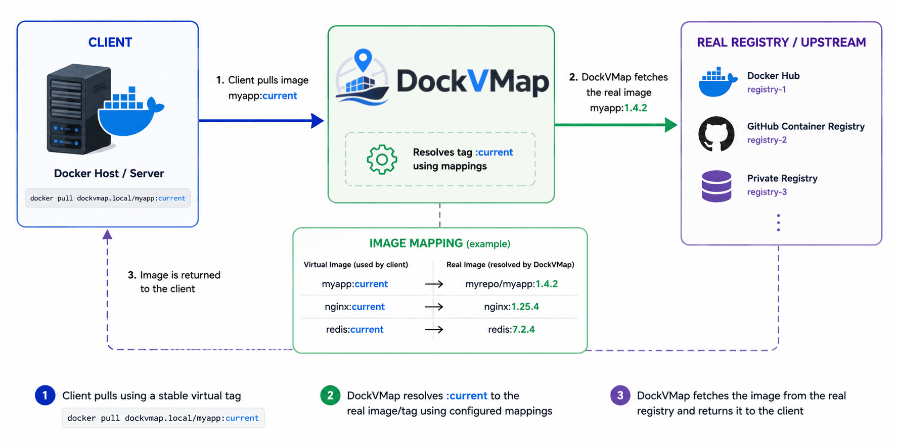
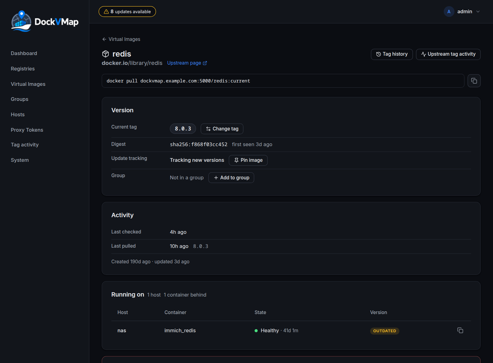
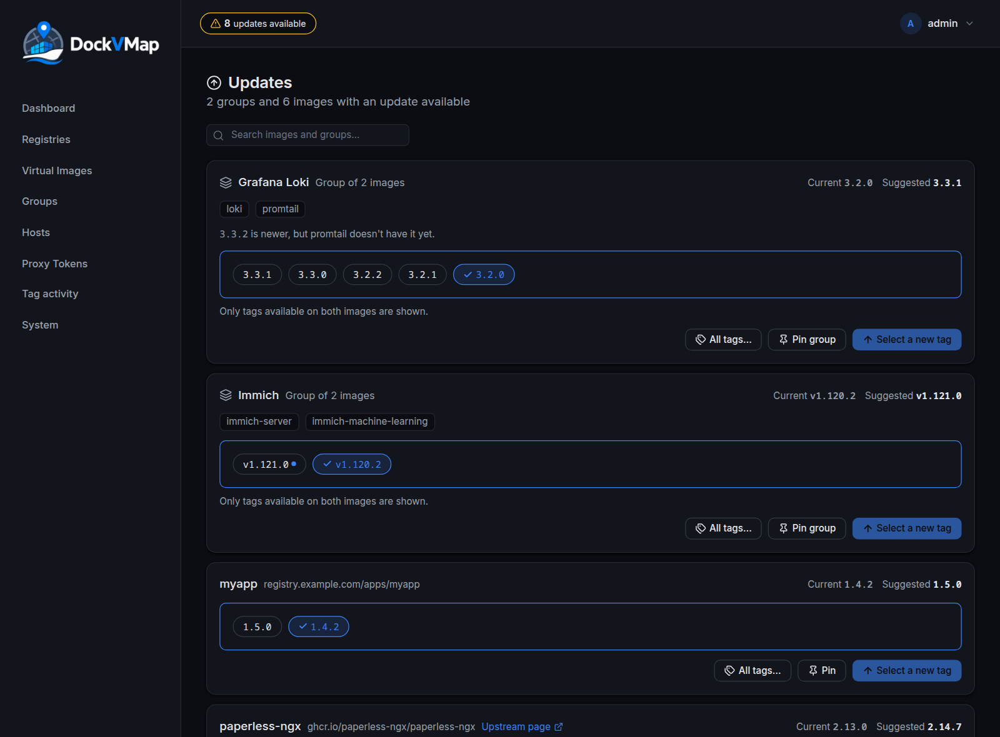

<p align="center">
  
</p>

<h1 align="center">DockVMap</h1>

<p align="center">A self-hosted Docker/OCI registry proxy that gives you a stable tag pointing at a real image version you control.</p>

<p align="center">
  <a href="LICENSE"></a>
  
  
</p>

---

## What it is

DockVMap sits between your Docker clients and a real registry (Docker Hub, GHCR, a private registry, anything speaking the OCI Distribution API). Clients pull a **virtual tag**:

```
docker pull dockvmap.local/myapp:current
```

`current` isn't a real tag upstream. It's a pointer DockVMap keeps, and you choose in the web UI which real tag (`myapp:1.4.2`, say) it resolves to. Clients never change what they pull; you change what they get.

Tools that list tags, like skopeo, crane, Renovate or diun, see only the virtual tag, so tracking the digest of `myapp:current` tells them when you move it.

<p align="center">
  
</p>

### Why

`:latest` moves under you with no warning and no record. Pinning a version everywhere turns every rollout into a find-and-replace across configs. DockVMap gives clients one fixed reference and you full control over what it resolves to, with a history of every change.

## Screenshots

<p align="center">
  
</p>

<p align="center">
  
</p>

<p align="center">
  
</p>

<p align="center">
  
</p>

## Features

- **Virtual tags**: clients pull a stable tag that resolves to the real tag you chose for each image.
- **Update tracking**: a repository's tags are grouped into families, and a newer tag in the same family is flagged. The Updates page lists them all.
- **Image groups**: images that release together move to a new tag together or not at all. Related images are suggested.
- **Pinning**: keep an image on its tag; tags are still checked, but no update is flagged.
- **Tag and digest history**: every tag a virtual tag pointed to, and the digest behind the current one, so a republished tag is noticed.
- **Pull tracking**: when each image was last pulled and which tag clients got, and when each proxy token was last used.
- **Hosts**: a small read-only agent shows what runs on each Docker host and which containers need a redeploy. See [Hosts and the agent](#hosts-and-the-agent).
- **Registry browsing**: browse a registry's repositories and tags, and add a virtual image in one click. See [Browse a registry](#browse-a-registry).
- **Internal registry**: push and pull your own images through the same address, with the official `registry:3` behind DockVMap. See [Internal registry](#internal-registry).
- **Replication**: read-only followers serve pulls from a copy of the primary, as a failover standby or a read replica at another site. See [Replication and follower mode](#replication-and-follower-mode).
- **Notifications**: digest emails and webhooks when tags change.
- **Proxy tokens, audit log, blob cache**: optional Basic Auth on the proxy, every change recorded with who made it, and an optional on-disk cache for repeated pulls.

## How it runs

One binary and one SQLite database, running a **proxy server** (the OCI Distribution API), a **web server** (REST API and web UI) and a **background worker** (tag checks, notifications, cleanup). A [replication](#replication-and-follower-mode) primary also serves its followers on a fourth port. The optional host agent is a separate binary.

## Quick start

```bash
docker run -d --name dockvmap \
  -v dockvmap-data:/data \
  -p 5000:5000 -p 8080:8080 \
  ghcr.io/septi0/dockvmap:latest
```

Open `http://localhost:8080`, create the admin account, and point Docker clients at the proxy on `:5000`. `/data` holds the database, keys and blob cache. Settings are `DOCKVMAP_*` environment variables (see [Configuration](#configuration)).

Images for `linux/amd64` and `linux/arm64` are `ghcr.io/septi0/dockvmap` and `ghcr.io/septi0/dockvmap-agent`, tagged `latest`, `MAJOR.MINOR` and the full version.

### Docker Compose

Copy `compose.sample.yaml` to `compose.yaml`, adjust it, and run `docker compose up -d`. For your own registry behind DockVMap, start from `compose.registry.sample.yaml` instead (see [Internal registry](#internal-registry)).

### Build from source

Needs Go 1.25+ and Node.js.

```bash
git clone https://github.com/septi0/dockvmap.git
cd dockvmap
make build          # frontend, bin/dockvmap and bin/dockvmap-agent
mkdir -p data
cp config.sample.yaml data/config.yaml
./bin/dockvmap -config data/config.yaml
```

The config file is optional. A plain `go build ./...` fails on a fresh checkout, since the embedded frontend isn't committed; run `make build` first.

## Behind a reverse proxy

When a reverse proxy terminates TLS for the web UI:

- Set [`trusted_proxies`](#networking) to the proxy's address: `gateway` if it reaches DockVMap through a published port, or its own address on a shared Docker network.
- Stop publishing `:8080`, so the proxy is the only way in.

Otherwise anything that reaches `:8080` directly can fake `X-Forwarded-For`, which defeats client-address logging and the login rate limit.

## Hosts and the agent

See which containers run on each Docker host, and whether those pulled through DockVMap run the version you chose. A small agent on each host reads Docker, and DockVMap connects to it. The agent never connects anywhere and never changes anything, so only DockVMap needs a firewall rule to reach your hosts.

### Setup

1. On **Hosts**, click **Add host** and enter the address DockVMap reaches it on, like `10.0.20.15` or `nas.lan:9002`.
2. On that host, copy `compose.agent.sample.yaml` to `compose.yaml` and run `docker compose up -d`. Allow DockVMap to reach the agent's port, `9002` by default.
3. At its next check, DockVMap pairs with the agent and the host shows as Online.

### Pairing

The first DockVMap to reach an agent pairs with it: both sides keep each other's certificate fingerprint and talk only to each other over TLS. There are no tokens to copy.

- **An agent paired with another DockVMap** refuses this one. To move it, delete the agent's volume and start it again.
- **An agent with a new identity**, after its volume was deleted or the host reinstalled, shows **Agent identity changed** until you click **Trust new agent**.
- **DockVMap's side** is `<data-path>/agent_client.pem`. Back it up with the database, or every agent has to be reset.

### Agent settings

| Variable | Default | Description |
|---|---|---|
| `DOCKVMAP_AGENT_LISTEN` | `:9002` | Address the agent listens on. |
| `DOCKVMAP_AGENT_PROXY_ONLY` | `false` | Report only containers whose image comes through DockVMap. Needs [`proxy_public_host`](#networking) set on DockVMap. |
| `DOCKER_HOST` | `unix:///var/run/docker.sock` | Docker to read: a `unix://` socket, or `tcp://` to a socket proxy. |
| `DOCKVMAP_LOG_LEVEL` | `info` | `debug`, `info`, `warn` or `error`. |

Mount a volume at `/data` for the agent's state. The agent logs its fingerprint at startup, to compare with the one on the host's page.

A socket mounted `:ro` still allows everything. For strictly read-only access, put a socket proxy in front, like [tecnativa/docker-socket-proxy](https://github.com/Tecnativa/docker-socket-proxy) with `CONTAINERS=1 IMAGES=1 INFO=1 EVENTS=1 VERSION=1`, and set `DOCKER_HOST: tcp://socket-proxy:2375`. The sample compose file shows how.

### What it reports

The host (hostname, OS, architecture, CPUs, memory, Docker version) and each container (name, image, state, health, exit code, compose project and folder, times and published ports). Never environment variables, mounts, other labels or logs.

DockVMap checks every agent every [`agents_poll_interval`](#core) (30s), and live while a host's page is open. A host that misses 3 checks shows as Offline, with its last known containers.

### Versions

A container whose image comes through DockVMap, like `dockvmap.local:5000/myapp:current`, is matched to its virtual image by digest, so set [`proxy_public_host`](#networking) to the address clients pull from. One that doesn't run the version you chose shows **Needs a redeploy to run 1.4.2**.

The dashboard's To redeploy card lists those containers per stack, with a command to run on that host, like `cd /srv/shop && docker compose pull web api && docker compose up -d web api`. The counts ("2 of 5 to redeploy") refresh by themselves, so you can watch a deploy reach every host. Hosts that are offline or can't read Docker are shown as left out.

"Crashed" counts containers that keep restarting or crashed in the last 7 days; exit codes 137 and 143 come from a normal `docker stop` and don't count.

### Limits

- Docker Engine 20.10 or newer. Podman is untested.
- Docker over TLS with client certificates isn't supported; use the local socket or a socket proxy.
- Up to 1000 containers and 2000 images per host.
- Agents don't need updating on every release; a host whose agent is too old shows **Update agent**.

`make build-agent` builds the agent as one static binary; `Dockerfile.agent` builds its image.

## Browse a registry

Registries that list their repositories (`/v2/_catalog`), like `registry:3` or the internal registry, get a Browse icon on Registries; Docker Hub and GHCR don't list theirs. Browse shows up to 1000 repositories, opens a repository's tags in families, and **Add virtual image** starts the wizard filled in. Browsing never changes the registry. It uses the registry's saved login, and some registries list only for some accounts (Harbor: admins only).

## Internal registry

Run the official `registry:3` in the same stack, with only DockVMap exposed, and push and pull every image through DockVMap's address. The registry stores images and handles uploads; DockVMap handles TLS and who can pull or push.

### Setup

1. Copy `compose.registry.sample.yaml` to `compose.yaml` and run `docker compose up -d`. It runs DockVMap with `DOCKVMAP_INTERNAL_REGISTRY_ENABLED: "true"` next to a `registry` service with no published port.
2. Create the admin account. Registries lists the internal registry first.
3. Push: `docker push localhost:5000/team/web:v1`.
4. For a virtual tag, add a virtual image on **Internal registry**, repository `team/web`, then `docker pull localhost:5000/web:current`.

The registry is reached over plain HTTP on the stack network and must not require a login.

### Moving an existing registry

1. Mount its data folder as `/var/lib/registry` in the `registry` service.
2. Remove its TLS settings (`REGISTRY_HTTP_TLS_*`) and any `htpasswd` login, and stop publishing its port.
3. If virtual images already use it, change its registry entry's address to `registry:5000` first, so DockVMap takes the entry over and they keep working.
4. Turn on `internal_registry.enabled`, and point clients at DockVMap's address.

### Keeping an existing registry as it is

To put DockVMap in front of a registry that already serves TLS, without changing it or its clients:

1. Set `internal_registry.address` to the name its certificate is for, like `registry.example.com:5000`, and turn on `internal_registry.tls`. The certificate must come from a CA DockVMap trusts, like Let's Encrypt.
2. Turn on `internal_registry.enabled`. An existing registry entry with that address is taken over.

Clients that use the registry directly keep working, but their pushes aren't audited and show only at the next tag check. To finish the move later, follow [Moving an existing registry](#moving-an-existing-registry) and turn `internal_registry.tls` off.

### How requests are routed

- **A virtual image's name**: the virtual tag is resolved, other tags pass through to its registry, pushes are refused.
- **Any other name**: passed to the internal registry, pushes included.
- **A virtual image on the internal repository of the same name**, like `myapp` on `myapp`: pulls go to the virtual image, pushes and the tag list to the registry. Pushing the virtual tag is refused.

### Who can push

With [`proxy_auth`](#proxy-authentication-proxy_auth) on, pulls need a proxy token and pushes a token with **Can push**. With it off, anyone who can reach the proxy can push, and DockVMap warns about it.

`internal_registry.push_allowed_ips` limits pushes and deletes to your build hosts; others get `403` naming their address. With `proxy_auth` on, a push needs both. Behind a reverse proxy, set [`trusted_proxies`](#networking) too.

Every push is audited as `IMAGE_PUSHED` and every delete as `MANIFEST_DELETED`, with the token and address. A push starts a tag check of the virtual images on that repository within seconds. Containers running a real name, like `dockvmap.lan:5000/team/web:latest`, show **Needs a redeploy** once a new image is pushed to their tag.

### Good to know

- The internal registry's entry follows `internal_registry.address`; changing the address moves it, with its virtual images. If the registry isn't up at startup, DockVMap starts anyway and keeps checking.
- `dockvmap -backup` covers the database only; back up the registry's volume separately.
- Garbage collection is the registry's job. Run it when nothing is pushing, then restart the registry, which until then still reports the removed layers as present:
  `docker compose exec registry registry garbage-collect --delete-untagged /etc/distribution/config.yml && docker compose restart registry`
  `--delete-untagged` also frees the images left behind when a tag is pushed again; multi-arch images stay complete. On `registry:2` the config is `/etc/docker/registry/config.yml`.
- If DockVMap's own image is in the internal registry, don't pull it through DockVMap, or you can't deploy DockVMap while it's down. Publish the registry on loopback only (`127.0.0.1:5000:5000`) and pull from `127.0.0.1:5000`.
- Don't delete the tag a virtual image points to; it would show under Problems.
- While DockVMap is down, nothing can push or pull real names.

## Replication and follower mode

Run a second DockVMap as a read-only follower of your main one, the primary. It keeps a copy of everything its proxy needs: virtual images, groups, pins, registries with their logins, proxy tokens, and every image in the internal registry. Use it as a failover standby or a read replica at another site.

A follower has no web UI: its web port answers only health checks and a page naming its primary, and pushes get `405`. Everything is managed on the primary.

### How it works

- The follower connects to the primary's replication port and gets each change within about a second. The connection uses TLS with the primary's identity pinned in the token, so there's no certificate to manage.
- Pushes and deletes through DockVMap are copied to the follower's registry, with every platform and only the layers it lacks. A virtual tag moves only once its image has arrived.
- A daily reconcile copies whatever the follower lacks, missing layers included, and counts the tags the primary doesn't have as `extraTags`, without deleting them. Deletes happen only when the primary recorded them, or on `dockvmap -resync`.
- Pulls on a follower are reported to the primary every minute, so "last pulled" stays true. Accounts, the audit log, hosts, tag history and tag checks exist only on the primary.

### Setup

1. On the primary, turn on replication and publish its port on the primary's own address, not a floating one:

   ```yaml
   replication:
     enabled: true
     listen: ":9003"
     allowed_ips: ["10.0.0.12"]
   ```

2. Restart it, open **System › Replication** and click **Add replication token**. The token is shown once, inside a ready follower config. Followers can share a token, but giving each its own lets you cut one off without the others.
3. On the follower, run the same stack as the primary, with its own `registry:3`, and that config:

   ```yaml
   follower:
     enabled: true
     primary: 10.0.0.11:9003
     token: dvmr1-…
   ```

4. Start it. It copies everything by itself. The primary's **System › Replication** page lists it by its IP with its progress; click it for details or to give it a name.

The follower must match the primary's `virtual_tag`, `proxy_auth.enabled`, `tls.enabled`, `internal_registry.enabled` and its registry's `REGISTRY_STORAGE_DELETE_ENABLED`; otherwise it stops syncing and names the setting.

The token gives a follower every registry login on the primary: keep it like a password, and delete it when a follower is retired. `replication.allowed_ips` makes a leaked token useless elsewhere. `replication.pem` in the primary's data folder is as secret as the database.

`allowed_ips` needs the follower's real address. Docker's NAT keeps it by default, but its userland proxy (rootless Docker, or briefly while Docker starts) makes every connection come from the bridge gateway and get `403`. Never add that gateway to `allowed_ips`.

### Failover and read replicas

With [keepalived](https://keepalived.org) or similar, clients use one floating address that moves to the follower when the primary's host is down. Both nodes publish the proxy on that address (with `net.ipv4.ip_nonlocal_bind=1`) and on their own:

| Port | Primary (10.0.0.11) | Follower (10.0.0.12) |
|---|---|---|
| Registry proxy | `10.0.0.10:5000`, `10.0.0.11:5000` | `10.0.0.10:5000`, `10.0.0.12:5000` |
| Web UI | `10.0.0.11:8080`, `127.0.0.1:8080` | `127.0.0.1:8080` (health checks) |
| Replication | `10.0.0.11:9003` | none |

Both nodes need the TLS certificate for the floating name. Each keepalived checks its own node, with `curl -sf http://127.0.0.1:8080/health/ready` (or `curl -sfk https://127.0.0.1:8443/health/ready` with `tls.enabled`). A follower is ready once it has the primary's data and images, even with the primary down; a returning primary once its database and registry work, so the address doesn't move back too early.

A follower also serves pulls while the primary is up, like a MySQL read replica, so a tag pushed a moment ago can be `404` there until it's copied; put `/health/ready` in front of any load balancer. The primary's Hosts page recognises only containers pulled through its own address or `proxy_public_host`.

### Health

`GET /health/ready` is on the web port and needs no login. It answers `200` when ready and `503` when not, with JSON details: on a follower `sync` (`running`, or why it stopped), `appliedVersion`, `primaryVersion`, `lastContactAt`, `pendingRepositories`, `failedCopies`, `extraTags` (`null` until the first reconcile), `copyError` and `lastError`; on the primary, its connected followers. The primary's Replication page shows the same for each follower, and a follower that stops connecting, stops syncing or fails to copy shows under Problems on the dashboard. Keep `GET /health` as the container healthcheck, so a follower that's behind isn't restarted.

### Runbook

- **The primary is down:** the follower keeps serving pulls, and catches up when the primary is back.
- **A follower was down:** it catches up when it starts. Deletes older than 30 days are missed; the reconcile counts them in `extraTags`, and `dockvmap -resync` removes them.
- **The primary was restored from an older backup:** followers stop syncing and keep serving. Check what happened, then run `dockvmap -resync` on each follower (with Docker: `docker compose exec -u dockvmap dockvmap dockvmap -resync`).
- **A follower's registry was lost or damaged:** `dockvmap -resync -yes` copies everything missing, layers included, and removes what the primary doesn't have.
- **The primary's registry was lost:** restore it before resyncing a follower, since a resync removes what the primary lacks. While the primary's registry is empty, a resync keeps everything.
- **A DockVMap with its own virtual images becomes a follower:** it waits for `dockvmap -resync` before replacing them.
- **Garbage collection:** run it on every node's registry and restart each afterwards; deletes reach followers, the space they free doesn't.
- **The primary is lost:** rebuild it from its backup, including `replication.pem`. Promoting a follower isn't supported: its first tag check would announce every tag as new.

## Configuration

Settings come from a YAML file (`-config`, optional), `DOCKVMAP_*` environment variables, or both; an env var wins over the file. Env var names are the keys uppercased with `.` as `_` (`smtp.host` is `DOCKVMAP_SMTP_HOST`), and lists are comma-separated. Every setting is optional; `none` means unset and `auto` means derived from other settings. [`config.sample.yaml`](config.sample.yaml) is a starting point; these tables are the complete list. The data folder is the `-data-path` flag (see [CLI](#cli)).

### Core

| Key | Default | Description |
|---|---|---|
| `virtual_tag` | `current` | The tag clients pull instead of a real one. |
| `tags_check_interval` | `24h` | Time between upstream tag checks. Restarts don't reset it. |
| `agents_poll_interval` | `30s` | How often DockVMap asks each agent for changes. |
| `tag_discovery_ttl` | `1h` | How long a repository's tag list is cached when adding a virtual image. |
| `session_lifetime` | `168h` | Web UI session duration. |
| `logs_path` | none | Directory for log files. Unset logs to stdout only. |
| `log_level` | `info` | `debug`, `info` or `warn`. `debug` traces every proxy request. |
| `tag_filters_path` | none | Your `filters.yaml` (see [Tag filtering](#tag-filtering)). Unset uses the built-in filters. |
| `credential_encryption_key` | none | Base64 32-byte key for stored registry logins. Unset generates `<data-path>/credential_encryption.key`. |

### Networking

| Key | Default | Description |
|---|---|---|
| `proxy_server_listen` | `:5000` | Registry proxy address; HTTPS with `tls.enabled`. |
| `proxy_public_host` | none | The host clients use in `docker pull`, like `registry.example.com:5050`. Used in pull commands and to match containers on hosts. Unset guesses from the web UI's address. |
| `proxy_access_log` | `true` | One log line per `/v2/...` request, with the client, the resolved image and cache hit or miss. |
| `web_server_http_listen` | `:8080` | Web UI address without TLS. |
| `web_server_https_listen` | `:8443` | Web UI address with `tls.enabled`. |
| `trusted_proxies` | `[]` | IPs or CIDRs of reverse proxies trusted to report the client address. They must append to `X-Forwarded-For`, not pass it through. `gateway` is the container's default gateway, where Docker's published ports come from. Empty uses the connecting address and logs a warning. |
| `secure_cookies` | auto | Send the session cookie over HTTPS only. On with `tls.enabled` or `trusted_proxies`. |

### TLS (`tls`)

| Key | Default | Description |
|---|---|---|
| `tls.enabled` | `false` | Serve the proxy and web UI over HTTPS. |
| `tls.cert_file` | none | PEM certificate chain. Required with `tls.enabled`. |
| `tls.key_file` | none | PEM private key. Required with `tls.enabled`. |

### Blob cache (`blob_cache`)

On-disk cache of manifests and blobs at `<data-path>/cache`.

| Key | Default | Description |
|---|---|---|
| `blob_cache.enabled` | `true` | Turn the cache on. |
| `blob_cache.lifetime` | `24h` | How long an entry may go unused before it's dropped. |
| `blob_cache.cleanup_interval` | `1h` | How often the cache is trimmed. |
| `blob_cache.max_size` | `10GB` | Disk budget (`B` to `TB`). Over it, the least recently used entries go, down to about 90%. |

### Login rate limiting (`login_rate_limit`)

| Key | Default | Description |
|---|---|---|
| `login_rate_limit.enabled` | `true` | Lock out an address after too many failed logins. |
| `login_rate_limit.max_attempts` | `5` | Failed attempts allowed within the window. |
| `login_rate_limit.window` | `15m` | How long failures are counted, and the lockout lasts. |
| `login_rate_limit.bypass_ips` | `[]` | IPs or CIDRs never locked out. |

### Notifications (`smtp`, `webhooks`)

Sent after each scheduled tag check. Email is a digest of available updates and changed tags, and each account chooses every change, upgrades only, or none. Webhooks fire once per image, with an `updateAvailable` flag.

| Key | Default | Description |
|---|---|---|
| `smtp.enabled` | `false` | Turn on email. Needs `smtp.host` and `smtp.from`. |
| `smtp.host` | none | SMTP server. |
| `smtp.port` | `587` | SMTP port. |
| `smtp.username` | none | SMTP login. Blank sends without one. |
| `smtp.password` | none | SMTP password. |
| `smtp.from` | none | From address. |
| `smtp.tls` | `true` | Use STARTTLS. |
| `webhooks` | `[]` | URLs to POST on a tag change. |

### Proxy authentication (`proxy_auth`)

| Key | Default | Description |
|---|---|---|
| `proxy_auth.enabled` | `false` | Require HTTP Basic Auth on the proxy, with a proxy token from the web UI as the password. |

### Internal registry (`internal_registry`)

| Key | Default | Description |
|---|---|---|
| `internal_registry.enabled` | `false` | Pass names that aren't virtual images to a `registry:3` on DockVMap's network. See [Internal registry](#internal-registry). |
| `internal_registry.address` | `registry:5000` | The registry's `host:port`; with `tls`, the name its certificate is for. |
| `internal_registry.tls` | `false` | Connect over HTTPS and check the certificate. See [Keeping an existing registry as it is](#keeping-an-existing-registry-as-it-is). |
| `internal_registry.push_allowed_ips` | `[]` | IPs or CIDRs allowed to push and delete. Empty allows every address. See [Who can push](#who-can-push). |

### Replication (`replication`, `follower`)

A DockVMap is a primary or a follower, never both. See [Replication and follower mode](#replication-and-follower-mode).

| Key | Default | Description |
|---|---|---|
| `replication.enabled` | `false` | Let followers copy this DockVMap. |
| `replication.listen` | `:9003` | Replication port. Publish it on the primary's own address only. |
| `replication.allowed_ips` | `[]` | IPs or CIDRs of the followers. Others get `403` naming the address seen. Empty allows every address. |
| `follower.enabled` | `false` | Make this DockVMap a read-only follower, with no web UI. |
| `follower.primary` | none | The primary's own `host:port` for replication, never a floating address. |
| `follower.token` | none | A replication token from the primary's System › Replication page. |
| `follower.reconcile_interval` | `24h` | How often the follower compares its registry with the primary's, copies what's missing and counts what the primary doesn't have. `0` turns it off. |

## Tag filtering

Tags matching an exclude pattern are dropped before grouping, which keeps CI tags like `commit-<sha>` or `pr-<n>` out of the tag list. Set your own file with `tag_filters_path`:

```yaml
tag_filters:
  exclude:
    - "^commit-.*"
    - "^pr-.*"
```

Each entry is a regular expression matched against the tag. Without a file, the built-in list in `internal/tagfilter/filters.yaml` applies (CI commit and PR tags, cosign signatures). Your file replaces that list, and an empty `exclude` turns filtering off.

## CLI

```
dockvmap -config <path>              # config file (optional)
dockvmap -data-path <path>           # data folder: database, blob cache, keys
dockvmap -reset-password <username>  # print a new password and end that user's sessions (not on a follower)
dockvmap -refresh-tags               # check every image's tags once
dockvmap -backup <path>              # write a consistent copy of the database
dockvmap -resync [-yes]              # on a follower, take the primary's data and registry images at the next sync
dockvmap -version                    # print the version
```

Every command except `-config` and `-data-path` exits when done.

### Backup and restore

`-backup` writes a consistent copy of the database while DockVMap runs, to a path that doesn't exist yet. It doesn't migrate, so back up with your **current** binary before upgrading. It covers the database only; the [internal registry](#internal-registry)'s images are in the registry's volume. A full restore also needs:

- **The credential key**: `<data-path>/credential_encryption.key`, or your `credential_encryption_key`. Without it, stored registry logins can't be read.
- **The agent identity**: `<data-path>/agent_client.pem`. Without it, every agent has to be reset.
- **The replication identity**, on a primary: `<data-path>/replication.pem`. Without it, every follower needs a new token.
- **Your `config.yaml`**.

To restore, stop DockVMap, put the copy at `<data-path>/dockvmap.db` with the files above, and start the same version or newer.

## Development

```bash
make help              # list all targets
make dev               # backend and Vite dev server together (CONFIG=path for another config)
make verify            # lint, tests and frontend checks
make test-integration  # replication end to end in Docker (containers named dvm-testlab-*)
```

## Contributing

Bug reports and feature ideas are welcome as [issues](https://github.com/septi0/dockvmap/issues); pull requests aren't accepted for now. [CONTRIBUTING.md](CONTRIBUTING.md) describes how the project is built. To report a security problem, see [SECURITY.md](SECURITY.md).

## License

AGPL-3.0 (see [LICENSE](LICENSE)). You're free to use, modify and self-host it. If you run a modified version as a network service, you must make that modified source available to its users.
