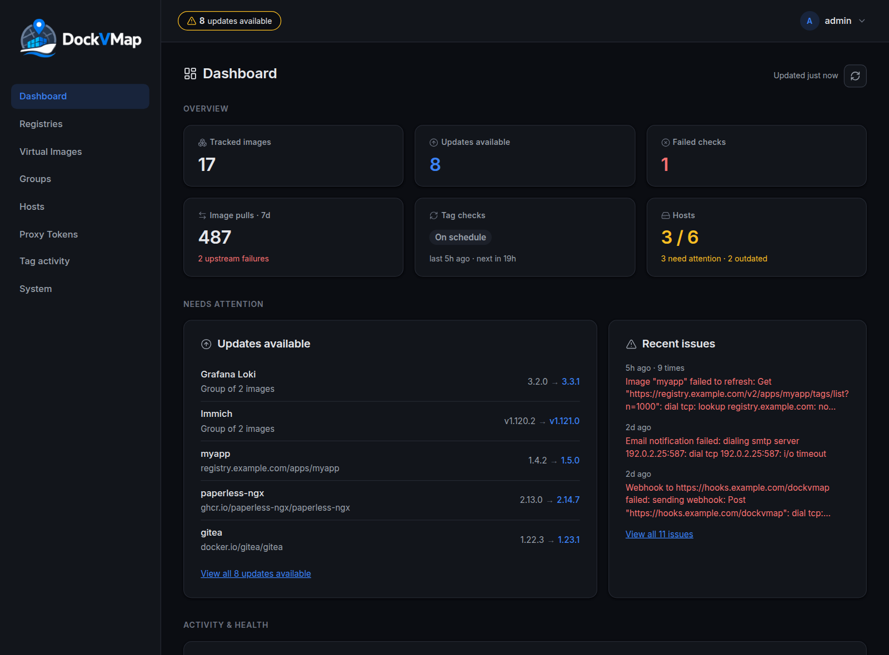
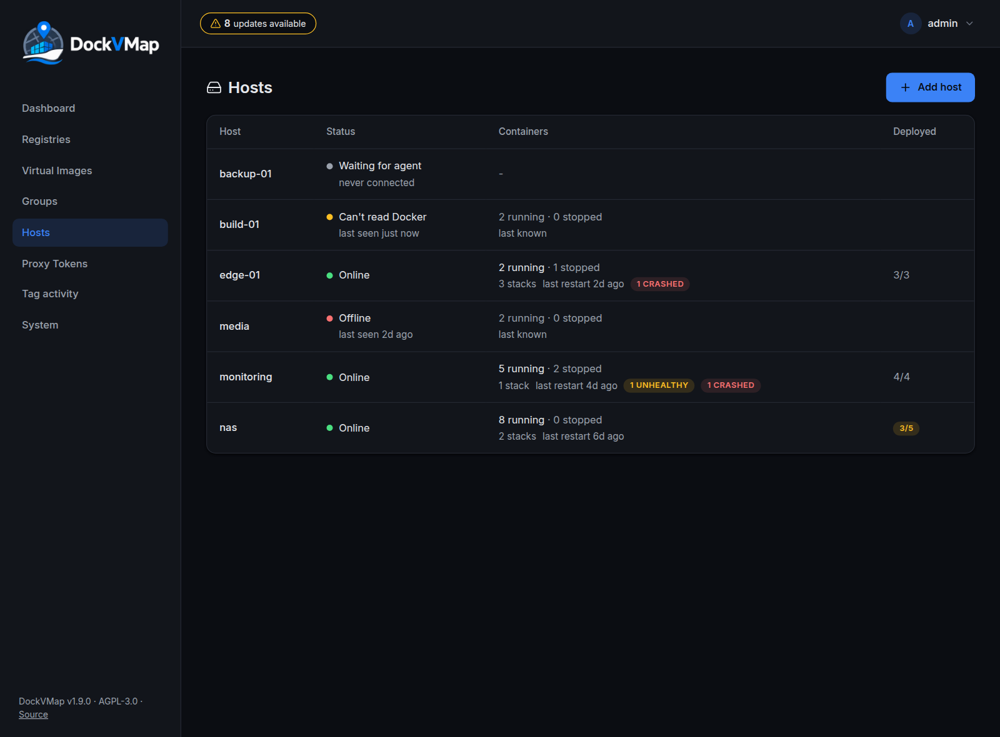

<p align="center">
  
</p>

<h1 align="center">DockVMap</h1>

<p align="center">A self-hosted Docker/OCI registry proxy that gives you a stable tag pointing at a real image version you control.</p>

<p align="center">
  <a href="LICENSE"></a>
  
  
</p>

---

## What it is

DockVMap sits between your Docker clients and a real registry (Docker Hub, GHCR, a private registry, or anything speaking the OCI Distribution API). You point clients at a **virtual tag**, e.g.:

```
docker pull dockvmap.local/myapp:current
```

`current` isn't a real tag on the upstream registry. It's a pointer DockVMap maintains. Behind it, you track a real upstream tag (`myapp:1.4.2`, say) per image, and change what `current` resolves to whenever *you* decide to, from a web UI. Clients never change what they pull; you change what they get.

Tools that list tags, like skopeo, crane, Renovate or diun, see only the virtual tag: `myapp` lists `current`. Renovate or diun tracking the digest of `myapp:current` then notices when you move the tag in DockVMap.

<p align="center">
  
</p>

### Why

`:latest` moves under you with no warning and no audit trail. Hardcoding a specific version tag everywhere it's referenced means every rollout is a find-and-replace across configs. DockVMap adds one layer of indirection so you get a fixed, predictable reference for clients *and* full control over what it actually resolves to, plus a record of when it changed and to what.

## Screenshots

<p align="center">
  
</p>

<p align="center">
  
</p>

<p align="center">
  
</p>

<p align="center">
  
</p>

## Features

- **Virtual tags**: clients pull a stable tag that DockVMap resolves to the real tag you chose for each image.
- **Update tracking**: DockVMap groups a repository's real tags into families and flags a newer tag in the same family. The Updates page lists every image with one, its newer tags side by side.
- **Image groups**: images that release together move to a new tag together or not at all, and review as one row. The Groups page suggests groups for images that look related.
- **Pinning**: keep an image on its tag; its tags are still checked, but no update is flagged or emailed.
- **Tag and digest history**: every tag a virtual tag pointed to and when, and the digest behind the current one, so a tag republished under the same name is noticed.
- **Pull tracking**: when each image was last pulled and which tag clients got, with a warning when nobody pulled since the last tag change. A pull that downloads nothing new isn't recorded. Each proxy token shows when it was last used.
- **Hosts**: a small read-only agent on each Docker host shows what runs where, and which containers need a redeploy to run the version you chose. See [Hosts and the agent](#hosts-and-the-agent).
- **Registry browsing**: the repositories and tags of any registry that lists them, with a virtual image added in one click. See [Browse a registry](#browse-a-registry).
- **Internal registry**: push and pull your own images through the same address, with the official `registry:3` behind DockVMap. See [Internal registry](#internal-registry).
- **Replication**: read-only followers serve pulls from a copy of the primary, as a failover standby or a read replica at another site. See [Replication and follower mode](#replication-and-follower-mode).
- **Notifications**: digest emails and webhooks when tags change, with email volume set per account.
- **Proxy tokens, audit log, blob cache**: optional Basic Auth on the proxy with issued tokens, every change recorded with its actor and client address, and an optional on-disk cache that cuts repeated upstream pulls.

## How it runs

One binary, one SQLite database, three things running inside it:

- a **proxy server** implementing the OCI Distribution API,
- a **web server** serving the REST management API and the embedded frontend,
- a **background worker** doing tag refresh, notifications, and cleanup on independent schedules.

A [replication](#replication-and-follower-mode) primary also serves its followers on a fourth port.

The optional host agent is a separate binary and image, run on each Docker host you want to see.

## Quick start

Run the published Docker image with a persistent `/data` volume (database, keys, blob cache) and two ports: `5000` for the registry proxy, `8080` for the web UI.

```bash
docker run -d --name dockvmap \
  -v dockvmap-data:/data \
  -p 5000:5000 -p 8080:8080 \
  ghcr.io/septi0/dockvmap:latest
```

Open `http://localhost:8080` and create the admin account, then point Docker clients at the proxy on `:5000`. Settings are `DOCKVMAP_*` environment variables (see [Configuration](#configuration)).

Images for `linux/amd64` and `linux/arm64` are published as `ghcr.io/septi0/dockvmap` and, for the host agent, `ghcr.io/septi0/dockvmap-agent`, tagged `latest`, `MAJOR.MINOR` and the full version.

### Docker Compose

Copy `compose.sample.yaml` to `compose.yaml`, adjust, and `docker compose up -d`. To run your own registry behind DockVMap, start from `compose.registry.sample.yaml` instead; see [Internal registry](#internal-registry).

### Build from source

Run without Docker. Requires Go 1.25+ and Node.js for the frontend build.

```bash
git clone https://github.com/septi0/dockvmap.git
cd dockvmap
make build          # builds the frontend, embeds it, builds bin/dockvmap and bin/dockvmap-agent
mkdir -p data
cp config.sample.yaml data/config.yaml
./bin/dockvmap -config data/config.yaml
```

The config file is optional; without it DockVMap runs on `DOCKVMAP_*` env vars and defaults.

> A plain `go build ./...` fails on a fresh checkout, because the frontend it embeds isn't committed. Run `make build` (or `make build-frontend` once) first.

## Behind a reverse proxy

When a reverse proxy terminates TLS and forwards to the web UI on `:8080`:

- Set `trusted_proxies` (or `DOCKVMAP_TRUSTED_PROXIES`) to the proxy's address: `gateway` if it reaches DockVMap through the published port, or the proxy's own address if it shares a Docker network. See [`trusted_proxies`](#networking) for the specifics.
- Stop publishing `:8080` to the host, so the proxy is the only route in.

Skip both and anything that can reach `:8080` directly can forge `X-Forwarded-For`, defeating client-IP logging and login rate limiting.

## Hosts and the agent

See which containers run on each Docker host, and whether the ones pulled through DockVMap run the version it points to. A small agent on each host reads Docker, and DockVMap connects to it. The agent never connects anywhere and never changes anything, so only DockVMap needs a firewall rule to reach your hosts.

### Setup

1. On the **Hosts** page, click **Add host**, give it a name and the address DockVMap reaches it on, like `10.0.20.15` or `nas.lan:9002`. DockVMap shows a ready-to-use compose file.
2. Run the agent on that host: copy `compose.agent.sample.yaml` to `compose.yaml` and `docker compose up -d`. Allow DockVMap to reach the host on the agent's port, `9002` by default.
3. On its next check, DockVMap adopts the agent and the host shows as Online.

### Pairing

The first time DockVMap reaches an agent, it adopts it: each side keeps the other's certificate fingerprint and from then on talks only to that one, over TLS. The agent keeps the pairing in its `/data` volume. There are no tokens to copy.

- **An agent paired with another DockVMap** refuses this one. To move it, delete the agent's volume and start it again.
- **An agent with a new identity**, after its volume was deleted or the host reinstalled, shows **Agent identity changed** and isn't read. If you reset it yourself, click **Trust new agent** on the host's page.
- **DockVMap's side** of the pairing is `<data-path>/agent_client.pem`. Back it up with the database, or every agent has to be reset.

### Agent settings

All settings are environment variables on the agent.

| Variable | Default | Description |
|---|---|---|
| `DOCKVMAP_AGENT_LISTEN` | `:9002` | Address the agent listens on for DockVMap. |
| `DOCKVMAP_AGENT_PROXY_ONLY` | `false` | Report only containers whose image comes through DockVMap's proxy. Needs [`proxy_public_host`](#networking) set on DockVMap. |
| `DOCKER_HOST` | `unix:///var/run/docker.sock` | Docker to read: a `unix://` socket, or `tcp://` to a socket proxy. |
| `DOCKVMAP_LOG_LEVEL` | `info` | `debug`, `info`, `warn` or `error`. |

Mount a volume at `/data` for the agent's state, as the sample compose file does. The agent logs its fingerprint at startup, to compare with the one on the host's page.

### Docker access

The agent only reads containers, images, system info and events. A socket mounted `:ro` still allows everything, so for strictly read-only access put a socket proxy in front, like [tecnativa/docker-socket-proxy](https://github.com/Tecnativa/docker-socket-proxy) with `CONTAINERS=1 IMAGES=1 INFO=1 EVENTS=1 VERSION=1`, and set `DOCKER_HOST: tcp://socket-proxy:2375`. The sample compose file shows where.

### What it reports

- **The host**: hostname, OS, architecture, CPUs, memory and Docker version.
- **Each container**: name, image, state and health, exit code, compose project, service and folder, its created, started and stopped times, and its published ports.

Never environment variables, mounts, other labels or logs. DockVMap asks every agent for changes every [`agents_poll_interval`](#core) (30 seconds), and right away when you open a host's page. A host that misses 3 checks in a row shows as Offline, with its last known containers.

### Versions

A container whose image comes through DockVMap's proxy, like `dockvmap.local:5000/myapp:current`, is matched to its virtual image by digest. One that doesn't run the version you chose shows **Needs a redeploy to run 1.4.2**; one on another tag shows the tag it's pinned to.

The dashboard's To redeploy card lists those containers by stack, with one command per stack to run on that host, like `cd /srv/shop && docker compose pull web api && docker compose up -d web api`. It touches only those containers. Containers started without Compose get no command. Host pages, Image details, Virtual Images ("2 of 5 to redeploy") and Hosts show the same counts and refresh by themselves, so you can watch a deploy reach every host. Only running or crash-looping containers on the virtual tag count, and hosts that are offline or can't read Docker are shown as left out.

On the Hosts list, "crashed" counts containers that keep restarting or crashed in the last 7 days; exit codes 137 and 143 come from a normal `docker stop` and don't count.

Matching uses the address clients pull from, so set [`proxy_public_host`](#networking).

### Limits

- Docker Engine 20.10 or newer (API 1.41). Podman is untested.
- Docker over TLS with client certificates isn't supported; use the local socket, or a socket proxy over `tcp://`.
- Up to 1000 containers and 2000 images per host.
- Agents don't need updating on every release. A host whose agent is too old shows **Update agent**.

### Build from source

`make build-agent` builds `bin/dockvmap-agent`, one static binary configured by the same environment variables, with `-data-path` (`./data` by default) and `-version`. `Dockerfile.agent` builds the image.

## Browse a registry

On Registries, a Browse icon shows on every registry that lists its repositories (`/v2/_catalog`), like `registry:3` or the internal registry; Docker Hub and GHCR don't. The Browse page lists up to 1000 repositories, with search and a filter for the ones with no virtual image yet. Open one to see its tags in families, and use **Add virtual image** to start the wizard with everything filled in. Browsing never changes the registry.

Listing uses the registry's saved login, and some registries allow it only for some accounts: Harbor lists repositories only for admins.

## Internal registry

Run the official `registry:3` in the same stack as DockVMap, with only DockVMap exposed, and push and pull every image through DockVMap's proxy address. The registry stores the images and does the uploads; DockVMap handles TLS and who can pull or push, and forwards everything else unchanged.

### Setup

1. Copy `compose.registry.sample.yaml` to `compose.yaml` and `docker compose up -d`. It runs DockVMap with `DOCKVMAP_INTERNAL_REGISTRY_ENABLED: "true"` next to a `registry` service whose port isn't published.
2. Open the web UI and create the admin account. The Registries page lists it first, marked "Internal registry"; DockVMap adds it at startup.
3. Push: `docker push localhost:5000/team/web:v1`.
4. For a virtual tag, add a virtual image from **Internal registry** and repository `team/web`, then `docker pull localhost:5000/web:current`. The repository field suggests what's already in the registry.

The internal registry is reached over plain HTTP on the stack network and must not require a login: DockVMap handles TLS and logins. For a registry that already serves TLS, see [Keeping an existing registry as it is](#keeping-an-existing-registry-as-it-is).

### Moving an existing registry

1. Mount the registry's existing data folder as `/var/lib/registry` in the `registry` service, so every image is kept.
2. Remove the registry's own TLS settings (`REGISTRY_HTTP_TLS_*`) and any `htpasswd` login, and stop publishing its port.
3. If virtual images already use that registry in DockVMap, edit its registry entry and change the address to `registry:5000` before turning the setting on. DockVMap takes that entry over at startup, so those virtual images keep working.
4. Turn on `internal_registry.enabled`, and point clients that pulled real names from the registry at DockVMap's proxy address.

### Keeping an existing registry as it is

To put DockVMap in front of a registry that already serves TLS, without changing the registry or the clients that use it directly:

1. Set `internal_registry.address` to the name and port its certificate is for, like `registry.example.com:5000`, and turn on `internal_registry.tls`. The certificate must be valid for that name and come from a CA DockVMap trusts, like Let's Encrypt.
2. Turn on `internal_registry.enabled`. If a registry entry already has that address, DockVMap takes it over, so its virtual images keep working.

Clients that use the registry directly keep working. Their pushes aren't in the audit log and show at the next scheduled tag check instead of within seconds. To finish the move later, follow [Moving an existing registry](#moving-an-existing-registry) and turn `internal_registry.tls` off.

### How requests are routed

- **A virtual image's name**: the virtual tag is resolved, other tags pass through to its registry, and pushes are refused.
- **Any other name**: passed through to the internal registry, pushes and `/v2/_catalog` included.
- **A virtual image built on the internal repository of the same name**, like `myapp` on `myapp`: pulls go to the virtual image, while pushes and the tag list go to the registry, so a CI check sees the tags you pushed. Pushing the virtual tag itself is refused.

Pulls of real names don't count in Last pulled or the dashboard's pull numbers.

### Who can push

With [`proxy_auth`](#proxy-authentication-proxy_auth) on, pulls need any proxy token and pushes need a token with **Can push**, chosen when you create it. With `proxy_auth` off, anyone who can reach the proxy can push, and DockVMap warns about it in the log and on Proxy Tokens.

To limit pushes by address, list your build hosts in `internal_registry.push_allowed_ips`. Pushes and deletes from any other address get `403` naming that address; pulls aren't affected. With `proxy_auth` on, a push needs both. A build host's address is in its `IMAGE_PUSHED` audit entry. Behind a reverse proxy, set [`trusted_proxies`](#networking) too, or every push seems to come from the proxy.

Every pushed tag is audited as `IMAGE_PUSHED` and every deleted manifest as `MANIFEST_DELETED`, with the token and client address.

### After a push

A pushed tag starts a tag check for the virtual images built on that repository about 5 seconds after the last push, so a new tag shows as an update within seconds.

Containers that run a real name through DockVMap, like `dockvmap.lan:5000/team/web:latest`, show as from the internal registry on their host's page, and as **Needs a redeploy to run the new image** once a new image is pushed to that tag.

### Startup and address changes

At startup DockVMap marks the registry entry for `internal_registry.address` as internal, taking over an entry with that address or adding one. If the address changes, the entry moves with it and its virtual images follow. Turning the setting off keeps the entry as a normal registry. If the registry doesn't answer at startup, DockVMap starts anyway, shows it under Problems and checks again every 10 seconds.

### Good to know

- Back up the registry's volume separately: `dockvmap -backup` covers the database only.
- Garbage collection is the registry's job: `docker compose exec registry registry garbage-collect --delete-untagged /etc/distribution/config.yml`, when nothing is pushing. `--delete-untagged` also frees the images left behind when a tag is pushed again; multi-arch images stay complete. On `registry:2` the config is `/etc/docker/registry/config.yml`.
- If DockVMap's own image lives in the internal registry, don't pull it through DockVMap, or you can't deploy DockVMap while it's down. Publish the registry for loopback only (`127.0.0.1:5000:5000`) and pull DockVMap as `127.0.0.1:5000/<name>`; Docker allows plain HTTP to `127.0.0.1`.
- With deletes on in the registry, don't delete the tag a virtual image points to; a virtual image whose tag is gone shows under Problems.
- If DockVMap is down, nothing can push or pull real names, since the registry isn't reachable from outside.

## Replication and follower mode

Run a second DockVMap as a read-only follower of your main one, the primary. It keeps a copy of everything its proxy needs: virtual images, groups, pins, registries with their logins, proxy tokens, and every image in the primary's internal registry. Use it as a failover standby, or as a read replica for hosts at another site.

A follower has no web UI: its web port answers only the health checks and a page naming its primary, and pushes get `405`. Everything is managed on the primary.

### How it works

- The follower connects out to the primary's replication port and waits for changes, so a change reaches it within about a second. Idle, this costs about 60 KB an hour; a change costs about 100 bytes per virtual image (50 KB with 500).
- Pushes and deletes through DockVMap are copied to the follower's registry: the tag, every platform, and only the layers it lacks. A virtual tag moves only once its image has arrived. Pushes made straight to the primary's registry are copied by the daily reconcile.
- Deletes are applied only when the primary recorded them; an image that is just missing on the primary is kept.
- Pulls served by a follower are reported to the primary every minute, so its "last pulled" and token "last used" stay true. Traffic counters, digests and the blob cache stay per node. Accounts, the audit log, hosts, tag history and tag checks exist only on the primary.
- The connection uses TLS with the primary's own identity, pinned through the replication token, so there's no certificate to buy or renew.

### Setup

1. On the primary, turn on replication and publish its port on the primary's own address, not a floating one:

   ```yaml
   replication:
     enabled: true
     listen: ":9003"
     allowed_ips: ["10.0.0.12"]
   ```

2. Restart it, open **System › Replication** and click **Add replication token**. The page shows the token once, inside a ready follower config. Give each follower its own token.
3. On the follower, run DockVMap with its own `registry:3`, the same stack as the primary, and that config:

   ```yaml
   follower:
     enabled: true
     primary: 10.0.0.11:9003
     token: dvmr1-…
   ```

4. Start it. It copies everything by itself; `curl http://10.0.0.12:8080/health/ready` shows its progress, and the primary lists it under Followers.

A follower's proxy must behave like the primary's: the same `virtual_tag`, `proxy_auth.enabled`, `tls.enabled` and `internal_registry.enabled`, and the same `REGISTRY_STORAGE_DELETE_ENABLED` on its registry. Otherwise it stops syncing and names the setting that differs.

The token gives a follower every registry login stored on the primary, so keep it like a password and delete it on the primary when a follower is retired. `replication.allowed_ips` makes a leaked token useless from anywhere else. `replication.pem` in the primary's data folder is as secret as the database.

### Failover and read replicas

With [keepalived](https://keepalived.org) or similar, clients use one floating address that moves to the follower when the primary's host is down. Both nodes publish the proxy on that address (with `net.ipv4.ip_nonlocal_bind=1`) and on their own:

| Port | Primary (10.0.0.11) | Follower (10.0.0.12) |
|---|---|---|
| Registry proxy | `10.0.0.10:5000`, `10.0.0.11:5000` | `10.0.0.10:5000`, `10.0.0.12:5000` |
| Web UI | `10.0.0.11:8080`, `127.0.0.1:8080` | `127.0.0.1:8080` (health checks) |
| Replication | `10.0.0.11:9003` | none |

Both nodes need the TLS certificate for the floating name. Each keepalived checks only its own node, like `curl -sf http://127.0.0.1:8080/health/ready`. A follower is ready once it has the primary's data and images and its setup matches, even with the primary down. A returning primary is ready once its database and registry work, so the address doesn't move back too early. `compose.registry.sample.yaml` is a starting point for both nodes.

A follower also serves pulls while the primary is up, like a MySQL read replica. A tag pushed a moment ago can answer `404` there until it's copied. Put `/health/ready` in front of any load balancer. The primary's Hosts page recognises only containers pulled through its own address or its `proxy_public_host`.

### Health

`GET /health/ready` on the web port needs no login and answers `200` when ready, `503` when not, with details as JSON. On a follower they include `sync` (`running`, or why it stopped), `appliedVersion`, `primaryVersion`, `lastContactAt`, `pendingRepositories`, `failedCopies` and `lastError`; on the primary, the followers connected right now. Keep `GET /health` as the container healthcheck, so a follower that is behind isn't restarted.

### Runbook

- **The primary is down:** the follower keeps serving pulls, and pushes and changes wait. It catches up when the primary is back.
- **A follower was down:** it catches up when it starts. Deletes older than 30 days aren't applied, so those images stay.
- **The primary was restored from an older backup:** followers stop syncing and keep serving. Check what happened, then run `dockvmap -resync` on each follower (with Docker: `docker compose exec -u dockvmap dockvmap dockvmap -resync`).
- **A follower's registry volume was lost:** `dockvmap -resync -yes` compares and copies every image again.
- **A DockVMap with its own virtual images becomes a follower:** it waits for `dockvmap -resync` before replacing them.
- **Garbage collection:** deletes reach followers, the space they free doesn't. Run `garbage-collect` on every node's registry.
- **The primary is lost:** rebuild it from its backup, including `replication.pem`. Promoting a follower isn't supported: it lacks the primary's tag lists, so its first tag check would announce every tag as new.

## Configuration

Settings come from a YAML file (`-config`, optional), `DOCKVMAP_*` environment variables, or both; an env var wins over the file, and the file over the default. Env var names are the YAML keys uppercased, with `.` as `_`: `smtp.host` is `DOCKVMAP_SMTP_HOST`. List values are comma-separated (`DOCKVMAP_TRUSTED_PROXIES=10.0.0.0/8,192.168.1.1`).

Every setting is optional; `none` means unset and `auto` means derived from other settings. [`config.sample.yaml`](config.sample.yaml) is a starting point, and these tables are the complete list. Where the database and keys live is the `-data-path` flag (see [CLI](#cli)).

### Core

| Key | Default | Description |
|---|---|---|
| `virtual_tag` | `current` | The tag name clients pull instead of a real upstream tag. |
| `tags_check_interval` | `24h` | Time between upstream tag checks. Restarts don't reset it. |
| `agents_poll_interval` | `30s` | How often DockVMap asks each host's agent for changes. |
| `tag_discovery_ttl` | `1h` | How long a repository's tag list, shown when adding a virtual image, is cached. |
| `session_lifetime` | `168h` | Web UI session duration. |
| `logs_path` | none | Directory for log files. Unset logs to stdout only. |
| `log_level` | `info` | `debug`, `info` or `warn`. `debug` adds per-request proxy tracing. |
| `tag_filters_path` | none | Path to your `filters.yaml` (see [Tag filtering](#tag-filtering)); it must exist. Unset uses the built-in filters. |
| `credential_encryption_key` | none | Base64, 32-byte key encrypting stored registry logins. Unset generates one at `<data-path>/credential_encryption.key`. |

### Networking

| Key | Default | Description |
|---|---|---|
| `proxy_server_listen` | `:5000` | Registry proxy bind address; HTTPS when `tls.enabled`. |
| `proxy_public_host` | none | Host clients use in `docker pull`, shown in pull commands and used to match containers on hosts. May include a port (`registry.example.com:5050`) when the public port differs. Unset guesses from the address you opened the web UI on. |
| `proxy_access_log` | `true` | One log line per `/v2/...` request (`component=proxy`), with the client, the resolved image and upstream, and cache hit or miss. |
| `web_server_http_listen` | `:8080` | Web UI bind address when `tls.enabled` is false. |
| `web_server_https_listen` | `:8443` | Web UI bind address when `tls.enabled` is true. |
| `trusted_proxies` | `[]` | IPs or CIDRs of reverse proxies trusted to report the client address. They must append to `X-Forwarded-For`, not pass it through. `gateway` means the container's default gateway, where Docker's published ports come from (`["gateway", "10.20.45.23"]`). Covers the web UI and the proxy. Empty uses the connecting address and logs a warning. |
| `secure_cookies` | auto | Send the session cookie over HTTPS only. On when `tls.enabled` or `trusted_proxies` is set. |

### TLS (`tls`)

| Key | Default | Description |
|---|---|---|
| `tls.enabled` | `false` | Serve the proxy and the web UI over HTTPS; the web UI moves to `web_server_https_listen`. |
| `tls.cert_file` | none | PEM certificate chain. Required with `tls.enabled`. |
| `tls.key_file` | none | PEM private key. Required with `tls.enabled`. |

### Blob cache (`blob_cache`)

On-disk cache of manifests and blobs at `<data-path>/cache`.

| Key | Default | Description |
|---|---|---|
| `blob_cache.enabled` | `true` | Turn the cache on. |
| `blob_cache.lifetime` | `24h` | How long an entry may go unused before it's dropped. |
| `blob_cache.cleanup_interval` | `1h` | How often expired entries are dropped and `max_size` enforced. |
| `blob_cache.max_size` | `10GB` | Disk budget (`B` to `TB`). Over it, the least recently used entries go, down to about 90%. |

### Login rate limiting (`login_rate_limit`)

| Key | Default | Description |
|---|---|---|
| `login_rate_limit.enabled` | `true` | Lock out an address after too many failed logins. |
| `login_rate_limit.max_attempts` | `5` | Failed attempts allowed within the window. |
| `login_rate_limit.window` | `15m` | How long failed attempts are counted, and the lockout lasts. |
| `login_rate_limit.bypass_ips` | `[]` | IPs or CIDRs never locked out. |

### Notifications (`smtp`, `webhooks`)

Sent after each scheduled tag check. Email is a digest: one listing available updates and one listing new and removed tags, with each account choosing every change, upgrades only, or off. Webhooks fire once per image with an `updateAvailable` flag.

| Key | Default | Description |
|---|---|---|
| `smtp.enabled` | `false` | Turn on email. Requires `smtp.host` and `smtp.from`. |
| `smtp.host` | none | SMTP server hostname. |
| `smtp.port` | `587` | SMTP server port. |
| `smtp.username` | none | SMTP login. Blank sends without one. |
| `smtp.password` | none | SMTP password. |
| `smtp.from` | none | From address. |
| `smtp.tls` | `true` | Use STARTTLS. |
| `webhooks` | `[]` | URLs POSTed on a tag change. |

### Proxy authentication (`proxy_auth`)

| Key | Default | Description |
|---|---|---|
| `proxy_auth.enabled` | `false` | Require HTTP Basic Auth on the proxy, with a proxy token from the web UI as the password. |

### Internal registry (`internal_registry`)

| Key | Default | Description |
|---|---|---|
| `internal_registry.enabled` | `false` | Pass names that aren't virtual images through to a `registry:3` on DockVMap's network. See [Internal registry](#internal-registry). |
| `internal_registry.address` | `registry:5000` | The registry's `host:port`; with `tls` on, the name its certificate is for. |
| `internal_registry.tls` | `false` | Connect over HTTPS and check the certificate. See [Keeping an existing registry as it is](#keeping-an-existing-registry-as-it-is). |
| `internal_registry.push_allowed_ips` | `[]` | IPs or CIDRs allowed to push and delete, like `["10.0.0.5", "10.0.1.0/24"]`. Empty allows every address. See [Who can push](#who-can-push). |

### Replication (`replication`, `follower`)

A DockVMap is a primary or a follower, never both. See [Replication and follower mode](#replication-and-follower-mode).

| Key | Default | Description |
|---|---|---|
| `replication.enabled` | `false` | Let followers copy this DockVMap. |
| `replication.listen` | `:9003` | Replication port. Publish it on the primary's own address only. |
| `replication.allowed_ips` | `[]` | IPs or CIDRs of the followers, like `["10.0.0.12"]`. Others get `403` naming the address seen, which with rootless Docker or Docker's userland proxy can be a Docker gateway address. Empty allows every address. |
| `follower.enabled` | `false` | Make this DockVMap a read-only follower, with no web UI. |
| `follower.primary` | none | The primary's own `host:port` for replication, never a floating address. |
| `follower.token` | none | A replication token from the primary's System › Replication page. |
| `follower.reconcile_interval` | `24h` | How often the follower compares its registry with the primary's and copies what's missing. `0` turns it off. |

## Tag filtering

Tags matching an exclude pattern are dropped before DockVMap groups them into families, which keeps CI tags like `commit-<sha>` or `pr-<n>` out of the tag list. The rules live in their own file, set with `tag_filters_path`:

```yaml
tag_filters:
  exclude:
    - "^commit-.*"
    - "^pr-.*"
```

Each entry is a regular expression matched against the tag name. Without `tag_filters_path`, the built-in list in `internal/tagfilter/filters.yaml` applies (CI commit and PR tags, cosign signatures). Your file replaces that list rather than adding to it, and an empty `exclude` turns filtering off.

## CLI

```
dockvmap -config <path>              # path to config file (optional; falls back to DOCKVMAP_* env vars and defaults if unset)
dockvmap -data-path <path>           # path to the data directory: SQLite database, blob cache, credential key (optional)
dockvmap -reset-password <username>  # generate and print a new password, invalidate their sessions, exit (on the primary, not a follower)
dockvmap -refresh-tags               # refresh tags for all configured images from their upstream registries, exit
dockvmap -backup <path>              # write a consistent copy of the database to <path>, exit
dockvmap -resync [-yes]              # on a follower, replace its data with the primary's at the next sync, exit
dockvmap -version                    # print version and exit
```

### Backup and restore

`-backup` writes a consistent copy of the database while DockVMap runs, to a path that must not exist yet. It doesn't migrate, so back up with your **current** binary before an upgrade.

It covers the database only: the [internal registry](#internal-registry)'s images live in the registry's volume, which you back up separately. A full restore also needs:

- **The credential key**: `<data-path>/credential_encryption.key`, or your `credential_encryption_key` value. Without it, stored registry logins can't be read.
- **The agent identity**: `<data-path>/agent_client.pem`. Without it, every host agent has to be reset.
- **The replication identity**, on a primary: `<data-path>/replication.pem`. Without it, every follower needs a new token.
- **Your `config.yaml`**.

To restore, stop DockVMap, put the copy at `<data-path>/dockvmap.db` with the files above, and start the same version or newer.

## Development

```bash
make help    # list all targets
make dev     # backend (go run) + frontend (vite dev server) together
make dev CONFIG=path/to/config.yaml   # ... against an alternative config file
make test    # go test ./...
make test-integration   # replication end-to-end tests in Docker (containers named dvm-testlab-*)
make check   # frontend svelte-check + tsc
make lint    # gofmt + go vet (+ golangci-lint if installed)
make verify  # lint + test + check, in one go
```

## License

AGPL-3.0 (see [LICENSE](LICENSE)). You're free to use, modify, and self-host this. If you run a modified version as a network service, you're required to make that modified source available to its users; that's the one condition of this license.
